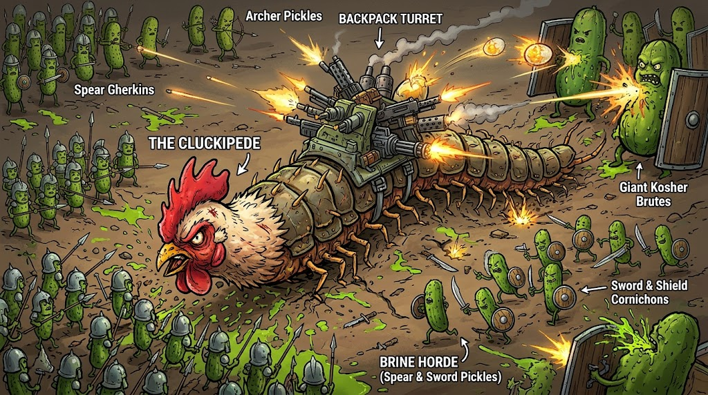

# The Cluckipede vs. The Brine Horde

A browser game prototype (Three.js + Vite) built from the [design concept](docs/DESIGN.md).
You play a rooster-headed, turret-laden arthropod slithering across the shattered shells of
the **Infinite Egg** and mowing down medieval pickle armies on your way down to the yolk.



## Play

```bash
npm install
npm run dev        # http://localhost:5173
npm run build      # static build in dist/ (relative paths, host anywhere)
npm test           # world-generation sanity tests (Node, no GPU needed)
```

URL options: `?seed=1234` gives a reproducible egg; `?nobloom` turns off bloom; `?noshadow` turns off shadows.

### Controls (Scheme C: Slither & Slingshot)

| Input | Action |
| --- | --- |
| `A`/`D`, `←`/`→`, or move the mouse | Slither (steer). The mouse steers toward the cursor. |
| Hold `Space` / `Shift` / left mouse | **Coil**: slow down and turn tighter while charging the slingshot |
| Release | **Slingshot** burst: rams through pickles (it even breaks braced phalanxes) |
| `P` / `Esc` | Pause |
| `M` | Mute |
| `B` | Toggle bloom |
| Touch | Drag to steer toward your finger, hold COIL (or put a second finger down) to coil, ❚❚ to pause. Portrait and landscape both work. |

## What's implemented

| Design pillar | How it plays |
| --- | --- |
| **Turn-radius physics** | Turn rate = speed / `R_min` (5 u). Causeways are exactly `3.4 × R_min` wide, so you can U-turn on them at full speed. Coiling drops `R_min` to 2.8. |
| **Broadside crossfire** | Each turret is welded to a segment and faces port or starboard with a limited arc, and auto-fires at pickles inside it. Curl into a C or S and every inward-facing gun converges. The backpack minigun on segment 1 swivels 360°. |
| **Dynamic camera** | 45° ¾ tilt by default. Pitches toward 85° top-down when you coil, wind up the slingshot, or get near a chasm edge (the screen edge also glows red). |
| **Recursive egg** | The active layer is always R0 = 100. The next two layers render inside it at ≈0.77× and ≈0.59× (the design's 0.65× spacing with the gap shrunk by a third), glowing amber through the chasms, so you can scout what's below. Descending runs a continuous zoom: the inner layer grows into the active slot while the old shell expands and fades away. |
| **Shattered plates** | Each layer is a signed distance field over the sphere: Voronoi plates (about 30% missing, which makes the huge voids), noisy cracks between plates, great-circle causeways forming a guaranteed-connected spanning tree plus extra loops, and dead-end peninsulas. The shell mesh is clipped along the zero contour, then given ink rims and cliff walls with a glowing yolk band. |
| **Chalaza Funnel** | Golden spiral whirlpool on the plate farthest from spawn, guarded by a squad. The HUD compass points to it. Entering it gives **+1 Depth** (+20% damage and armour) and **Metabolic Molting** (regrows the spine, repairs armour, recovers drifting tails). |
| **Void free-fall** | Driving off a ledge drops you to the next layer anyway, but rips off 40% of your tail (at least 2 segments) and gives no depth buff, while enemies there are scaled for the deeper layer. |
| **Spine-as-health** | Each segment has armour plating; a broken segment is destroyed and everything behind it detaches as a writhing tail. Touch it with your head within 12 s to re-attach it, turrets included. Pickles will try to finish it off. Hits on the head drain from the tail end. Losing the last segment means death. |
| **Calcified caches** | Egg-shaped geodes at the tips of dead-end peninsulas. Ram one to weld a Broadsider, Flak Blunderbuss, Mortar Tube or Flame Cooker onto the first empty slot, or onto a newly grown segment if none is free. |
| **The Brine Horde** | **Spear Gherkins** march in phalanxes and brace spears when you charge them head-on. **Scimitar Cornichons** zig-zag in, go for the tail, slash and retreat. **Longbowmen** keep their distance and lob telegraphed mustard-seed arrows (explosive, area damage) that lead your movement. **Kosher Dill Brutes** carry tin-can tower shields that block frontal fire, so flank them or use mortars and flame. |
| **Art style** | Stepped toon shading with screen-space cross-hatching in the shadow bands; world-space clay grime (stains, thumbprints, scratches); baked clay AO; cast shadows for a miniature-diorama look; two ink layers (inverted-hull silhouettes plus a depth-Laplacian line pass whose lines boil at 12 fps); warm umber/amber grade, vignette and 12 fps film grain; chartreuse brine splats; amber bloom. Enemies, their poses and turret recoil all update on 12 fps "twos" with a little stop-motion boil, while the snake and camera run at full frame rate. |

All audio is synthesised in WebAudio, so there are no asset files apart from the concept art used on the title screen.

## Code map

```
src/
  config.js      tuning knobs (R0, R_min, speeds, palette)
  sphere.js      surface-of-a-sphere math, seeded RNG, value noise
  world.js       Layer: plate/causeway/peninsula SDF, clipped shell mesh, props, funnel, caches
  cluckipede.js  the player: trail-following spine, slingshot, severing/re-attach, molting
  weapons.js     turret types + meshes, bullet & lobbed-projectile simulation
  enemies.js     Brine Horde meshes, AI, squads, stop-motion rendering
  camera.js      45° ↔ 85° dynamic rig with parallel-transported forward vector
  fx.js          instanced particles, ground splats, telegraph rings
  post.js        ink-line and film-grade post-processing passes
  hud.js         DOM HUD (spine bar, slingshot meter, funnel compass, messages)
  audio.js       procedural sound effects
  main.js        game loop, collisions, layer transitions, game states
```

`window.__game` exposes the running game in the console for debugging.
