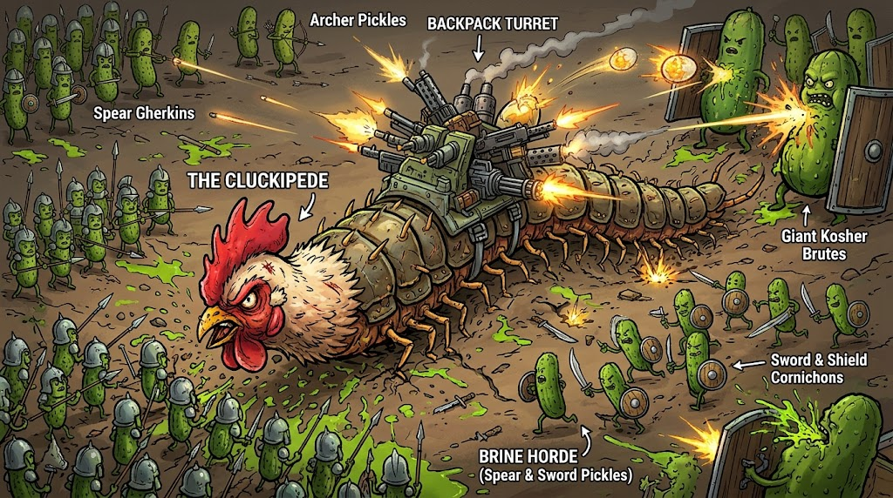

# Game Concept Summary: The Cluckipede vs. The Brine Horde

## 1. Core Concept & Protagonist
- **The Protagonist:** The Cluckipede — a multi-segmented arthropod body fused with a fierce, red-crested white rooster head, featuring a heavy brass backpack turret rig bristling with miniguns, flak cannons, and mortar tubes.
- **Core Loop:** Slither through concentric, nested spherical worlds (The Infinite Egg), manage your physical spine as health and ammo platforms, and descend layers by locating the exit funnel while fighting off medieval pickle armies.

## 2. Movement & Control (Scheme C: Slither & Slingshot)
- **Turn Radius Physics (R_min):** The world architecture is built on vast, shattered continental plates separated by massive void chasms, ensuring causeways are wide enough (3.4 × R_min) for high-speed U-turns and full 360-degree coils.
- **Broadside Crossfire Mechanics:** Guns are fixed broadside to specific body segments. Curling your spine into a "C" or "S" shape focuses perpendicular tracer fire inward to create lethal crossfire kill-zones.
- **Dynamic Camera Rig:** Defaults to a readable 45° 3/4 isometric tilt to scout under-shell glowing yolk layers below, automatically pitching up to 85° top-down during tight coils or chasm edge proximity.

## 3. The Egg Architecture & Level Progression
- **Recursive World Scaling:** Active layers sit at a fixed canonical radius (R0 = 100), while inner layers (L1, L2) are rendered concentrically inside at fractional scales (0.65×, 0.42×). Descending triggers a seamless zoomquilt scale transition.
- **The Chalaza Funnel (Proper Descent):** A golden, spiral-grooved yolk whirlpool exit that grants a permanent +1 Depth Level (scaling damage/defense by 20%) and triggers Metabolic Molting to instantly regrow severed segments and repair armor.
- **Void Free-Fall Penalty:** Skipping the funnel by falling raw off a chasm ledge bypasses the depth buff and causes severe tail-segment loss, making survival on tougher lower layers punishing.

## 4. Segments & Modular Loadouts
- **Spine-as-Health:** Each body segment acts as 1 HP. If enemy infantry hacks through your spine, the trailing tail segments detach and writhe; you can loop back to re-attach them before they are destroyed.
- **Calcified Weapon Caches:** Found on dead-end peninsulas; cracking them open welds new modular turrets (flame cookers, mortars, broadsiders) directly onto empty spine slots.

## 5. The Brine Horde (Enemy Ecosystem)
- **Spear Gherkins:** Stubby, neon-chartreuse infantry phalanxes in pot-helmets, locking cocktail spears shoulder-to-shoulder.
- **Scimitar Cornichons:** Agile, dark-green zig-zagging skirmishers with serrated butter-knife blades and red chili-flake speckles.
- **Bread-and-Butter Longbowmen:** Lanky, crinkle-cut amber archers firing mustard-seed explosive arrows across chasms.
- **Kosher Dill Brutes:** Hulking, knobby-skinned heavy brutes wielding interlocking tower shields hammered from tin cans and jar rings.

## 6. Visual Art Style
- **Aesthetic:** Grimy Alchemical Stop-Motion — blending the tactile, hand-crafted clay and kitbash textures of miniature dioramas with bold comic-ink outlines.
- **Color Palette:** High-contrast pairing of matte ivory eggshell continents and warm, glowing amber-yolk gold under-shell illumination against toxic electric chartreuse and neon-green brine splatters.
- **Animation Cadence:** Enemies and mechanical recoils animate on snappy 12-fps stop-motion "twos" against buttery 60-fps camera slithering.
